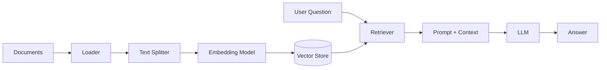

# Generative AI with LangChain

> A hands-on learning project for building chat-model integrations, RAG
> pipelines, and AI agents with LangChain.

[](https://www.python.org/)
[](https://www.langchain.com/)
[](LICENSE)
[](#current-status)

---

## Table of Contents

- [About](#about)
- [Current Status](#current-status)
- [Learning Roadmap](#learning-roadmap)
- [Available Examples](#available-examples)
- [Tech Stack](#tech-stack)
- [How RAG Fits Together](#how-rag-fits-together)
- [Project Structure](#project-structure)
- [Getting Started](#getting-started)
- [Environment Variables](#environment-variables)
- [Troubleshooting](#troubleshooting)
- [Security Note](#security-note)
- [What I'm Learning](#what-im-learning)
- [License](#license)
- [Author](#author)

---

## About

This repository is my hands-on workspace for learning **Generative AI
engineering**. Instead of only watching tutorials, I build small working
examples for chat models, retrieval-augmented generation (RAG), embeddings,
and tool-using agents.

The project follows my ML learning path:

```text
Classical ML -> Deep Learning -> Transformers -> Generative AI
```

The foundations live in
[ML-Foundations](https://github.com/gyr0byte/ML-Foundations); this repository
focuses on applying those concepts with LangChain and provider APIs.

## Current Status

This repository is actively being developed as a learning project.

### Implemented

- Chat model examples using Groq, Google Gemini, Mistral, and Hugging Face
- An interactive Mistral terminal chatbot with conversation history
- A Streamlit Mistral chatbot UI with selectable personas
- CineSage, a Streamlit movie-information extraction application
- A Hugging Face hosted endpoint example
- A local TinyLlama text-generation example
- Google Gemini and Hugging Face embedding examples
- Initial RAG document-loader examples for PDFs, web pages, and text files
- Initial RAG text-splitting examples using character, recursive-character,
  and token-based splitters
- A partial PDF-to-chat RAG experiment in `RAG/main.py`
- Environment-variable loading with `python-dotenv`
- Dependency management with `uv`
- Project configuration for LangChain, LangGraph, Hugging Face, FAISS, and
  FastAPI

### Planned

- Completing the RAG pipeline in [`RAG/main.py`](RAG/main.py)
- Vector search using FAISS and/or another vector store
- LangGraph-based agents and tool calling
- FastAPI examples
- RAG over the notebooks from ML-Foundations

## Learning Roadmap

- [x] **Chat models:** Chat models, messages, prompts, and provider
  integrations
- [x] **Hugging Face models:** Hosted and local text-generation models through
  LangChain
- [x] **Chatbot interfaces:** Terminal and Streamlit interfaces with
  conversation history
- [x] **Structured extraction:** Pydantic-validated movie information
  extraction with Groq
- [x] **Embeddings:** Convert text into vectors with Google Gemini and
  Hugging Face models
- [ ] **RAG:** Document loading and text splitting are started; embeddings,
  vector stores, retrieval, and the end-to-end pipeline remain
- [ ] **AI agents:** Tool calling, agent loops, human-in-the-loop workflows,
  and external APIs
- [ ] **Own project:** RAG over my ML-Foundations notebooks

## Available Examples

### Hosted provider chat models

[`Chat_Models/chat.py`](Chat_Models/chat.py) sends example prompts to three
providers:

- Groq using `openai/gpt-oss-20b`
- Google Gemini using `gemini-2.5-flash`
- Mistral using `ministral-14b-latest`

The script calls all three providers, so the three corresponding API keys must
be configured before running it.

From the repository root, run:

```bash
uv run python Chat_Models/chat.py
```

The responses are generated by external APIs and may vary between runs.

### Hugging Face hosted model

[`Chat_Models/huggingface.py`](Chat_Models/huggingface.py) uses
`HuggingFaceEndpoint` with the `deepseek-ai/DeepSeek-R1` repository through
Hugging Face's hosted inference service.

Run it with:

```bash
uv run python Chat_Models/huggingface.py
```

This example requires `HUGGINGFACEHUB_API_TOKEN`.

### Local Hugging Face model

[`Chat_Models/localmodel.py`](Chat_Models/localmodel.py) runs
`TinyLlama/TinyLlama-1.1B-Chat-v1.0` locally using a
`HuggingFacePipeline`. The model is downloaded and cached on the local
machine, so no Hugging Face API token is required after the dependencies and
model files are available.

Run it with:

```bash
uv run python Chat_Models/localmodel.py
```

The script currently sets the Hugging Face cache directory to
`D:\HuggingFace` on Windows. Change the `HF_HOME` value in the script if you
want to use a different location. Local inference also requires enough disk
space and memory for the model and its dependencies.

### Interactive Mistral terminal chatbot

[`Chat_Models/chatbot.py`](Chat_Models/chatbot.py) provides an interactive
terminal chatbot backed by `ministral-14b-latest`. It uses LangChain message
objects to preserve system, user, and assistant messages during the session.
The chatbot starts with a funny and witty system persona and exits when you
enter `0`.

Run it with:

```bash
uv run python Chat_Models/chatbot.py
```

This example requires `MISTRAL_API_KEY`.

### Streamlit Mistral chatbot

[`Chat_Models/chatbot_ui.py`](Chat_Models/chatbot_ui.py) provides a browser
interface for the Mistral chatbot. It includes:

- Funny, sad, angry, and flirty assistant personas
- Persona descriptions and greetings
- Conversation history stored in Streamlit session state
- A button to clear and restart the current conversation
- Styled chat messages and persona-specific avatars

Start the application with:

```bash
uv run streamlit run Chat_Models/chatbot_ui.py
```

Open the local URL printed by Streamlit in your browser. This example requires
`MISTRAL_API_KEY`.

### Embeddings

[`Embedding_Models/embeddings.py`](Embedding_Models/embeddings.py) creates
document embeddings with Google's `gemini-embedding-2` model and prints the
resulting vectors. It uses 64 dimensions and normalized embeddings.

Run it with:

```bash
uv run python Embedding_Models/embeddings.py
```

This example requires `GOOGLE_API_KEY`.

[`Embedding_Models/huggingface_embedding.py`](Embedding_Models/huggingface_embedding.py)
creates local embeddings with
`sentence-transformers/all-MiniLM-L6-v2`. It is configured to use CUDA and
stores Hugging Face downloads under `D:\HuggingFace` on Windows.

Run it with:

```bash
uv run python Embedding_Models/huggingface_embedding.py
```

This local example does not require an API key, but it requires a compatible
PyTorch installation and a CUDA-capable device with sufficient memory. Change
the `device` and `HF_HOME` values in the script if your environment uses a
different setup.

### RAG document loaders

The [`RAG/DocumentLoader/`](RAG/DocumentLoader/) folder contains small
experiments with LangChain document loaders:

- [`page.py`](RAG/DocumentLoader/page.py) loads a web page with
  `WebBaseLoader`.
- [`pdf.py`](RAG/DocumentLoader/pdf.py) loads `GRU.pdf` with
  `PyPDFLoader`.
- [`test.py`](RAG/DocumentLoader/test.py) loads `notes.txt` with
  `TextLoader`.

The folder also contains the source documents used by the examples:

- [`GRU.pdf`](RAG/DocumentLoader/GRU.pdf)
- [`deeplearning.pdf`](RAG/DocumentLoader/deeplearning.pdf)
- [`notes.txt`](RAG/DocumentLoader/notes.txt)

Run an individual loader from the repository root:

```bash
uv run python RAG/DocumentLoader/pdf.py
uv run python RAG/DocumentLoader/page.py
uv run python RAG/DocumentLoader/test.py
```

The web-page example requires an internet connection. The PDF and text
examples use the Windows paths currently defined in their scripts, so update
those paths if you run the project from another location or operating system.

### RAG text splitters

The [`RAG/TextSplitter/`](RAG/TextSplitter/) folder contains small experiments
that split loaded documents into chunks before a future retrieval step:

- [`character_based.py`](RAG/TextSplitter/character_based.py) uses
  `CharacterTextSplitter` on `notes.txt` with a chunk size of 10 and an
  overlap of 1.
- [`recursive_based.py`](RAG/TextSplitter/recursive_based.py) uses
  `RecursiveCharacterTextSplitter` on `GRU.pdf` with a chunk size of 1,000
  characters and an overlap of 10.
- [`token_based.py`](RAG/TextSplitter/token_based.py) uses
  `TokenTextSplitter` on `GRU.pdf` with a chunk size of 1,000 tokens and an
  overlap of 10.

Each script prints the generated chunks and is an isolated learning example;
the splitters are not yet connected to embeddings, a vector store, or a
retriever.

Run them from the repository root:

```bash
uv run python RAG/TextSplitter/character_based.py
uv run python RAG/TextSplitter/recursive_based.py
uv run python RAG/TextSplitter/token_based.py
```

The scripts currently use repository-specific Windows paths for their input
files. Update those paths before running them on another machine or operating
system.

### Incomplete RAG experiment

[`RAG/main.py`](RAG/main.py) is an incomplete first RAG experiment. It currently
loads `GRU.pdf`, formats the loaded pages into a chat prompt, and sends that
prompt to Mistral using `ministral-14b-latest`. It does not yet implement
question-based retrieval, text splitting, embeddings, a vector store, or a
retriever.

Do not treat it as a finished RAG application. It can be run experimentally
from the repository root with:

```bash
uv run python RAG/main.py
```

This example requires `MISTRAL_API_KEY`.

### CineSage movie intelligence

[`CineSage/core.py`](CineSage/core.py) defines the validated movie extraction
schema and model logic. It extracts details such as the title, media type,
release year, genres, cast, plot, themes, ratings, awards, and a concise
summary from a movie paragraph. The result is validated with Pydantic and can
be rendered as readable Markdown.

[`CineSage/coreUI.py`](CineSage/coreUI.py) provides the Streamlit interface.
Paste a movie description or use the example text, then select from raw model
output, validated structured data, or a readable Markdown presentation.

The application uses Groq's `openai/gpt-oss-120b` model with structured output.
Run it from the repository root with:

```bash
uv run streamlit run CineSage/coreUI.py
```

This example requires `GROQ_API_KEY` and a browser for the Streamlit interface.

## Tech Stack

### Currently used

- **Language:** Python 3.12+
- **Framework:** LangChain
- **LLM providers:** Groq, Google Gemini, Mistral, and Hugging Face
- **Local inference:** Hugging Face Transformers and PyTorch
- **Embeddings:** Google Gemini and Sentence Transformers
- **Structured output:** Pydantic models with LangChain
- **Document loading:** PDF, web-page, and text loaders from LangChain
- **Interactive CLI:** Python terminal input
- **Web UI:** Streamlit
- **Configuration:** `python-dotenv`
- **Package management:** `uv`

### Declared for upcoming examples

- **Vector search:** FAISS
- **Agent orchestration:** LangGraph
- **API serving:** FastAPI and Uvicorn
- **HTTP requests:** Requests
- **Additional providers:** OpenAI

ChromaDB, Tavily, and OpenWeather are part of the planned learning roadmap but
are not currently used by the implementation in this repository.

## How RAG Fits Together

The planned RAG examples will follow this general flow:



The current chat-model example does not use retrieval yet.

## Project Structure

```text
Generative-AI/
├── Chat_Models/
│   ├── chat.py             # Groq, Gemini, and Mistral examples
│   ├── chatbot.py          # Interactive Mistral terminal chatbot
│   ├── chatbot_ui.py       # Streamlit Mistral chatbot UI
│   ├── huggingface.py      # Hugging Face hosted endpoint example
│   └── localmodel.py       # Local TinyLlama pipeline example
├── Embedding_Models/
│   ├── embeddings.py       # Google Gemini embeddings example
│   └── huggingface_embedding.py # Local Sentence Transformers embeddings
├── CineSage/
│   ├── core.py             # Movie schema and extraction logic
│   └── coreUI.py           # Streamlit movie extraction interface
├── RAG/
│   ├── main.py             # Incomplete PDF-to-Mistral RAG experiment
│   ├── DocumentLoader/
│   │   ├── deeplearning.pdf # PDF source document
│   │   ├── GRU.pdf         # PDF source document
│   │   ├── notes.txt       # Text source document
│   │   ├── page.py         # WebBaseLoader example
│   │   ├── pdf.py          # PyPDFLoader example
│   │   └── test.py         # TextLoader example
│   └── TextSplitter/
│       ├── character_based.py  # CharacterTextSplitter example
│       ├── recursive_based.py  # RecursiveCharacterTextSplitter example
│       └── token_based.py      # TokenTextSplitter example
├── .env.example             # API-key variable template
├── .gitignore
├── .python-version          # Python 3.12
├── LICENSE
├── README.md
├── pyproject.toml           # Project metadata and dependencies
├── requirements.txt         # pip-compatible dependency list
└── uv.lock                  # Locked uv dependency versions
```

## Getting Started

### Prerequisites

- Python 3.12 or newer
- Git
- [uv](https://docs.astral.sh/uv/)
- API keys for the hosted providers used by the example
- A browser for the Streamlit UI
- A browser for the CineSage interface
- An internet connection for the web-page loader
- Sufficient memory for printing large document chunks
- Sufficient disk space and memory for local Hugging Face models
- A CUDA-capable device for `huggingface_embedding.py`, unless its device
  setting is changed to `cpu`

### Installation with uv

Clone the repository and install the locked dependencies:

```bash
git clone https://github.com/gyr0byte/Generative-AI.git
cd Generative-AI
uv sync
```

Create your local environment file:

```powershell
# Windows PowerShell
Copy-Item .env.example .env
```

```bash
# macOS/Linux
cp .env.example .env
```

Open `.env` and add your provider API keys. Do not add quotation marks unless
they are part of the key value.

### Installation with pip

If you prefer a standard virtual environment and `pip`:

```bash
python -m venv .venv
```

```powershell
# Windows PowerShell
.venv\Scripts\Activate.ps1
```

```bash
# macOS/Linux
source .venv/bin/activate
```

```bash
pip install -r requirements.txt
```

Then create `.env` as described above. The `pyproject.toml`/`uv.lock` setup
also includes the local inference dependencies (`torch`, `transformers`, and
`sentence-transformers`). If you use only `requirements.txt` and want to run
the local model, local embedding, Streamlit, or RAG PDF examples, install the
missing packages (`torch`, `transformers`, `sentence-transformers`, `streamlit`,
`pypdf`, and `beautifulsoup4`) separately.

### Run the examples

From the repository root:

```bash
uv run python Chat_Models/chat.py
```

Run the Hugging Face hosted example:

```bash
uv run python Chat_Models/huggingface.py
```

Run the local TinyLlama example:

```bash
uv run python Chat_Models/localmodel.py
```

Run the interactive Mistral chatbot:

```bash
uv run python Chat_Models/chatbot.py
```

Run the Streamlit Mistral chatbot:

```bash
uv run streamlit run Chat_Models/chatbot_ui.py
```

Run the Google Gemini embeddings example:

```bash
uv run python Embedding_Models/embeddings.py
```

Run the local Hugging Face embeddings example:

```bash
uv run python Embedding_Models/huggingface_embedding.py
```

Run the CineSage movie extraction application:

```bash
uv run streamlit run CineSage/coreUI.py
```

Run the incomplete RAG experiment:

```bash
uv run python RAG/main.py
```

Run the RAG text-splitting examples:

```bash
uv run python RAG/TextSplitter/character_based.py
uv run python RAG/TextSplitter/recursive_based.py
uv run python RAG/TextSplitter/token_based.py
```

When using the pip setup, activate the virtual environment first and replace
`uv run python` with `python`:

```bash
python Chat_Models/chat.py
python Chat_Models/huggingface.py
python Chat_Models/localmodel.py
python Chat_Models/chatbot.py
streamlit run Chat_Models/chatbot_ui.py
python Embedding_Models/embeddings.py
python Embedding_Models/huggingface_embedding.py
streamlit run CineSage/coreUI.py
python RAG/main.py
python RAG/TextSplitter/character_based.py
python RAG/TextSplitter/recursive_based.py
python RAG/TextSplitter/token_based.py
```

## Environment Variables

Copy [`.env.example`](.env.example) to `.env`. The examples use the following
variables:

| Variable | Required now | Purpose |
|---|:---:|---|
| `GROQ_API_KEY` | Yes | Groq chat model |
| `GOOGLE_API_KEY` | Yes | Google Gemini chat model |
| `MISTRAL_API_KEY` | Yes | Mistral chat model |
| `OPENAI_API_KEY` | No | Planned OpenAI examples |
| `HUGGINGFACEHUB_API_TOKEN` | Yes for `huggingface.py` | Hugging Face hosted inference |
| `TAVILY_API_KEY` | No | Planned web-search tools |
| `OPENWEATHER_API_KEY` | No | Planned weather tools |
| `LANGCHAIN_API_KEY` | No | Optional LangSmith tracing |

The local example in `localmodel.py` does not require an API key. It downloads
the model from Hugging Face and runs inference on the local machine.

The local Hugging Face embedding example also does not require an API key.
The Google Gemini embedding example requires `GOOGLE_API_KEY`.

CineSage requires `GROQ_API_KEY`.

The incomplete RAG experiment requires `MISTRAL_API_KEY`.

## Troubleshooting

### Authentication errors

Check that `.env` exists in the repository root and that the variable names
match [`.env.example`](.env.example). The hosted provider example needs the
Groq, Google, and Mistral keys. The Hugging Face hosted example additionally
needs `HUGGINGFACEHUB_API_TOKEN`.

### Running from the wrong directory

Run commands from the repository root:

```bash
uv run python Chat_Models/chat.py
```

### Provider or model errors

Provider model names and availability can change. If a provider rejects a
model name, check that provider's current model documentation and update
[`Chat_Models/chat.py`](Chat_Models/chat.py).

For the interactive chatbot, enter `0` to exit the session.

For the Streamlit chatbot, use the persona selector in the sidebar to start
or switch conversations, and use **Clear Conversation** to reset the current
history.

For Hugging Face errors, verify the repository ID, your access token, and
whether the selected hosted model is available for your account.

### Streamlit UI errors

Start the UI from the repository root with:

```bash
uv run streamlit run Chat_Models/chatbot_ui.py
```

If the `streamlit` command is unavailable, synchronize the `uv` environment
again with `uv sync`. The UI also requires `MISTRAL_API_KEY`.

For CineSage, run the application from the repository root so that
`CineSage/coreUI.py` can import the extraction logic from `CineSage/core.py`.
The application also requires `GROQ_API_KEY`.

For the RAG scripts, run commands from the repository root. The loader scripts
currently contain repository-specific Windows paths and may need path updates
on other machines.

The text-splitting scripts also use repository-specific Windows paths. Update
their input paths if the repository is stored elsewhere.

### Local model errors

The local example downloads a model the first time it runs. If it fails,
check your available disk space, memory, PyTorch installation, and the
`HF_HOME` path configured in
[`Chat_Models/localmodel.py`](Chat_Models/localmodel.py).

The Hugging Face embedding example is configured for CUDA. If CUDA is not
available, change `model_kwargs={"device": "cuda"}` to use `cpu`, noting that
CPU inference may be slower.

### Embedding errors

For Google embeddings, verify `GOOGLE_API_KEY` and the selected embedding model
availability. For local embeddings, verify that `sentence-transformers` is
installed and that the configured device is available.

### CineSage extraction errors

Enter a non-empty movie paragraph and verify that `GROQ_API_KEY` is configured.
If structured extraction fails, check Groq model availability and the response
shown in the raw-output tab.

### RAG errors

`RAG/main.py` is intentionally incomplete and currently sends the loaded PDF
content directly to the model rather than retrieving relevant chunks. If the
script fails, verify that `RAG/DocumentLoader/GRU.pdf` exists, that
`MISTRAL_API_KEY` is configured, and that the PDF paths match your environment.

The text-splitting examples print every generated chunk, so large source
documents can produce a large amount of terminal output. Verify the source
file paths and reduce the input document or chunk count if needed.

### Dependency errors

With `uv`, synchronize the environment again:

```bash
uv sync
```

With `pip`, make sure the virtual environment is activated before running:

```bash
pip install -r requirements.txt
```

## Security Note

**Never commit `.env` or any real API key.** The `.env` file is ignored by
[`.gitignore`](.gitignore), while only [`.env.example`](.env.example) is
tracked with empty values.

If a key is committed by mistake, deleting it is not enough because it may
remain in Git history. Revoke the key and generate a new one immediately.

## What I'm Learning

- How chat models, messages, and prompt templates work in LangChain
- How embeddings turn text into vectors and how similarity search works
- How RAG grounds an LLM's answers in custom documents
- How agents decide when to call tools
- How to keep a human in the loop
- How to structure, document, and ship small GenAI projects

## License

This project is licensed under the MIT License. See
[`LICENSE`](LICENSE) for details.

## Author

**gyr0byte**

- GitHub: [@gyr0byte](https://github.com/gyr0byte)

---

<p align="center"><i>Not a person, a process: always building, never stopping.</i></p>
