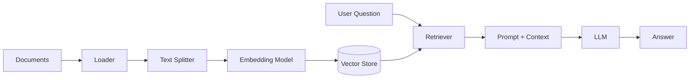

# Generative AI with LangChain

> A hands-on learning project for building chat-model integrations, RAG
> pipelines, and AI agents with LangChain.

[](https://www.python.org/)
[](https://www.langchain.com/)
[](LICENSE)
[](#current-status)

---

## Table of Contents

- [About](#about)
- [Current Status](#current-status)
- [Learning Roadmap](#learning-roadmap)
- [Available Examples](#available-examples)
- [Tech Stack](#tech-stack)
- [How RAG Fits Together](#how-rag-fits-together)
- [Project Structure](#project-structure)
- [Getting Started](#getting-started)
- [Environment Variables](#environment-variables)
- [Troubleshooting](#troubleshooting)
- [Security Note](#security-note)
- [What I'm Learning](#what-im-learning)
- [Resources](#resources)
- [License](#license)
- [Author](#author)

---

## About

This repository is my hands-on workspace for learning **Generative AI
engineering**. Instead of only watching tutorials, I build small working
examples for chat models, retrieval-augmented generation (RAG), embeddings,
and tool-using agents.

The project follows my ML learning path:

```text
Classical ML -> Deep Learning -> Transformers -> Generative AI
```

The foundations live in
[ML-Foundations](https://github.com/gyr0byte/ML-Foundations); this repository
focuses on applying those concepts with LangChain and provider APIs.

## Current Status

This repository is actively being developed as a learning project.

### Implemented

- Chat model examples using Groq, Google Gemini, and Mistral
- Environment-variable loading with `python-dotenv`
- Dependency management with `uv`
- Project configuration for LangChain, LangGraph, embeddings, FAISS, and
  FastAPI

### Planned

- Embedding examples in [`Embedding_Models/`](Embedding_Models/)
- Retrieval-augmented generation with a custom document corpus
- Vector search using FAISS and/or another vector store
- LangGraph-based agents and tool calling
- FastAPI and Streamlit examples
- RAG over the notebooks from ML-Foundations

## Learning Roadmap

- [x] **Chat models:** Chat models, messages, prompts, and provider
  integrations
- [ ] **Embeddings:** Convert text into vectors and compare semantic
  similarity
- [ ] **RAG:** Document loaders, text splitters, vector stores, and retrievers
- [ ] **AI agents:** Tool calling, agent loops, human-in-the-loop workflows,
  and external APIs
- [ ] **Own project:** RAG over my ML-Foundations notebooks

## Available Examples

### Chat models

[`Chat_Models/chat.py`](Chat_Models/chat.py) sends example prompts to three
providers:

- Groq using `openai/gpt-oss-20b`
- Google Gemini using `gemini-2.5-flash`
- Mistral using `ministral-14b-latest`

The script calls all three providers, so the three corresponding API keys must
be configured before running it.

From the repository root, run:

```bash
uv run python Chat_Models/chat.py
```

The responses are generated by external APIs and may vary between runs.

## Tech Stack

### Currently used

- **Language:** Python 3.12+
- **Framework:** LangChain
- **LLM providers:** Groq, Google Gemini, and Mistral
- **Configuration:** `python-dotenv`
- **Package management:** `uv`

### Declared for upcoming examples

- **Embeddings:** LangChain Hugging Face integrations and `tiktoken`
- **Vector search:** FAISS
- **Agent orchestration:** LangGraph
- **API serving:** FastAPI and Uvicorn
- **HTTP requests:** Requests
- **Additional providers:** OpenAI

ChromaDB, Streamlit, Tavily, and OpenWeather are part of the planned learning
roadmap but are not currently used by the implementation in this repository.

## How RAG Fits Together

The planned RAG examples will follow this general flow:



The current chat-model example does not use retrieval yet.

## Project Structure

```text
Generative-AI/
├── Chat_Models/
│   └── chat.py              # Groq, Gemini, and Mistral examples
├── Embedding_Models/       # Embedding examples planned here
├── .env.example             # API-key variable template
├── .gitignore
├── .python-version          # Python 3.12
├── LICENSE
├── README.md
├── pyproject.toml           # Project metadata and dependencies
├── requirements.txt         # pip-compatible dependency list
└── uv.lock                  # Locked uv dependency versions
```

## Getting Started

### Prerequisites

- Python 3.12 or newer
- Git
- [uv](https://docs.astral.sh/uv/)
- API keys for the providers used by the example

### Installation with uv

Clone the repository and install the locked dependencies:

```bash
git clone https://github.com/gyr0byte/Generative-AI.git
cd Generative-AI
uv sync
```

Create your local environment file:

```powershell
# Windows PowerShell
Copy-Item .env.example .env
```

```bash
# macOS/Linux
cp .env.example .env
```

Open `.env` and add your provider API keys. Do not add quotation marks unless
they are part of the key value.

### Installation with pip

If you prefer a standard virtual environment and `pip`:

```bash
python -m venv .venv
```

```powershell
# Windows PowerShell
.venv\Scripts\Activate.ps1
```

```bash
# macOS/Linux
source .venv/bin/activate
```

```bash
pip install -r requirements.txt
```

Then create `.env` as described above.

### Run the current example

From the repository root:

```bash
uv run python Chat_Models/chat.py
```

When using the pip setup, activate the virtual environment first and run:

```bash
python Chat_Models/chat.py
```

## Environment Variables

Copy [`.env.example`](.env.example) to `.env`. The current chat-model example
requires the first three variables below:

| Variable | Required now | Purpose |
|---|:---:|---|
| `GROQ_API_KEY` | Yes | Groq chat model |
| `GOOGLE_API_KEY` | Yes | Google Gemini chat model |
| `MISTRAL_API_KEY` | Yes | Mistral chat model |
| `OPENAI_API_KEY` | No | Planned OpenAI examples |
| `HUGGINGFACEHUB_API_TOKEN` | No | Planned Hugging Face examples |
| `TAVILY_API_KEY` | No | Planned web-search tools |
| `OPENWEATHER_API_KEY` | No | Planned weather tools |
| `LANGCHAIN_API_KEY` | No | Optional LangSmith tracing |

The current script does not require `OPENAI_API_KEY`, even though one of its
Groq model names contains `openai`.

## Troubleshooting

### Authentication errors

Check that `.env` exists in the repository root and that the variable names
match [`.env.example`](.env.example). The current example needs all three
provider keys because it makes requests to all three providers.

### Running from the wrong directory

Run the command from the repository root:

```bash
uv run python Chat_Models/chat.py
```

### Provider or model errors

Provider model names and availability can change. If a provider rejects a
model name, check that provider's current model documentation and update
[`Chat_Models/chat.py`](Chat_Models/chat.py).

### Dependency errors

With `uv`, synchronize the environment again:

```bash
uv sync
```

With `pip`, make sure the virtual environment is activated before running:

```bash
pip install -r requirements.txt
```

## Security Note

**Never commit `.env` or any real API key.** The `.env` file is ignored by
[`.gitignore`](.gitignore), while only [`.env.example`](.env.example) is
tracked with empty values.

If a key is committed by mistake, deleting it is not enough because it may
remain in Git history. Revoke the key and generate a new one immediately.

## What I'm Learning

- How chat models, messages, and prompt templates work in LangChain
- How embeddings turn text into vectors and how similarity search works
- How RAG grounds an LLM's answers in custom documents
- How agents decide when to call tools
- How to keep a human in the loop
- How to structure, document, and ship small GenAI projects

## Resources

- [Sheryians GenAI playlist](https://www.youtube.com/watch?v=vwncYfhxbR0&list=PLaldQ9PzZd9oXR4PMGR4pr_DX4wFHkFwR):
  main learning path
- [LangChain playlist](https://www.youtube.com/watch?v=pSVk-5WemQ0&list=PLKnIA16_RmvaTbihpo4MtzVm4XOQa0ER0):
  deeper dives on retrievers, text splitters, and runnables
- [LangChain documentation](https://python.langchain.com/)
- [FAISS documentation](https://faiss.ai/)
- [Hugging Face LLM Course](https://huggingface.co/learn/llm-course)
- [uv documentation](https://docs.astral.sh/uv/)

## License

This project is licensed under the MIT License. See
[`LICENSE`](LICENSE) for details.

## Author

**gyr0byte**

- GitHub: [@gyr0byte](https://github.com/gyr0byte)

---

<p align="center"><i>Not a person, a process: always building, never stopping.</i></p>
