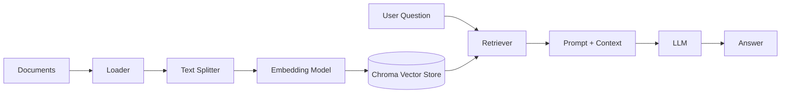

# 🤖 genai-langchain

> Learning Generative AI by building: LangChain chatbots, RAG pipelines, and AI agents.


---

## 📑 Table of Contents

- [About](#-about)
- [Learning Roadmap](#-learning-roadmap)
- [Projects](#-projects)
- [Tech Stack](#-tech-stack)
- [How It Fits Together](#-how-it-fits-together)
- [Project Structure](#-project-structure)
- [Getting Started](#-getting-started)
- [Environment Variables](#-environment-variables)
- [Security Note](#-security-note)
- [What I'm Learning](#-what-im-learning)
- [Progress Log](#-progress-log)
- [Resources](#-resources)
- [License](#-license)
- [Author](#-author)

---

## 📖 About

This repo is my hands-on workspace for learning **Generative AI engineering**. Instead of only watching tutorials, I build a working project for each topic: chat models, retrieval-augmented generation (RAG), and tool-using agents.

It follows my ML learning path (classical ML → deep learning → transformers → GenAI). The foundations live in [ML-Foundations](https://github.com/gyr0byte/ML-Foundations); this repo is where I build things with them.

---

## 🗺️ Learning Roadmap

- [ ] **Video 1: Chatbot project.** Chat models, embeddings, messages and conversations, prompt templates, structured output
- [ ] **Video 2: RAG.** Document loaders, text splitters, vector stores (Chroma), retrievers
- [ ] **Video 3: AI agents.** Tools vs agents, the agent loop (LLM → tool → result → LLM), human-in-the-loop, real-world APIs (weather, news)
- [ ] **Own project: RAG over my ML-Foundations notebooks.** Ask "explain gradient descent" and retrieve from my own notes

---

## 🧪 Projects

| # | Project | Concepts | Status |
|---|---------|----------|--------|
| 1 | Chatbot | Chat models, messages, prompt templates, structured output | ⬜ Not started |
| 2 | RAG pipeline | Loaders, splitters, embeddings, Chroma, retrievers | ⬜ Not started |
| 3 | AI agent | Tool calling, agent loop, human-in-the-loop | ⬜ Not started |
| 4 | RAG over my notes | Custom corpus, `HuggingFaceEmbeddings`, retrieval quality | ⬜ Not started |

> _Update this table as each project is completed, and link to its folder._

---

## 🛠️ Tech Stack

- **Language:** Python
- **Framework:** LangChain
- **Vector database:** ChromaDB
- **Embeddings:** HuggingFace (`sentence-transformers`) / OpenAI
- **LLM providers:** OpenAI, Mistral, Groq, Google (as needed)
- **External APIs:** Tavily (search/news), OpenWeather
- **UI:** Streamlit
- **Tooling:** Jupyter, python-dotenv, Pydantic

---

## 🔄 How It Fits Together



_This is the general RAG flow the projects build toward._

---

## 📁 Project Structure

```
genai-langchain/
├── .env.example        # placeholder key names only
├── .gitignore
├── .gitattributes
├── requirements.txt
├── LICENSE
└── README.md
```

> _Project folders will be added here as I build them._

---

## 🚀 Getting Started

### Prerequisites

- Python 3.10 or newer
- Git
- API keys for the providers you want to use (see [Environment Variables](#-environment-variables))

### Installation

```bash
# 1. Clone the repo
git clone https://github.com/gyr0byte/genai-langchain.git
cd genai-langchain

# 2. Create a virtual environment
python -m venv venv

# 3. Activate it
# Windows
venv\Scripts\activate
# macOS / Linux
source venv/bin/activate

# 4. Install dependencies
pip install -r requirements.txt

# 5. Set up your environment variables
cp .env.example .env      # Windows: copy .env.example .env
# then open .env and add your keys
```

### Running a project

Each project folder will have its own run instructions. Typical commands:

```bash
python chat.py               # a script
streamlit run app.py         # a Streamlit app
jupyter notebook             # a notebook
```

---

## 🔑 Environment Variables

Copy `.env.example` to `.env` and fill in only the keys you need:

| Variable | Used for |
|----------|----------|
| `OPENAI_API_KEY` | OpenAI chat and embedding models |
| `GROQ_API_KEY` | Groq-hosted LLMs |
| `GOOGLE_API_KEY` | Gemini models |
| `MISTRAL_API_KEY` | Mistral LLMs |
| `HUGGINGFACEHUB_API_TOKEN` | Hugging Face Hub models |
| `TAVILY_API_KEY` | Web search / news tool (agents) |
| `OPENWEATHER_API_KEY` | Weather tool (agents) |
| `LANGCHAIN_API_KEY` | Optional tracing |

---

## 🔒 Security Note

**Never commit `.env` or any real API key.** `.env` is listed in `.gitignore`, and only `.env.example` (with empty values) is tracked. If a key is ever committed by mistake, deleting it is not enough because it stays in git history. Revoke it and generate a new one immediately.

---

## 🧠 What I'm Learning

- How chat models, messages, and prompt templates work in LangChain
- How embeddings turn text into vectors, and how similarity search works
- How RAG grounds an LLM's answers in my own documents
- How agents decide when to call tools, and how to keep a human in the loop
- How to structure, document, and ship small GenAI projects

---

## 📈 Progress Log

| Date | Milestone |
|------|-----------|
| _TBD_ | Repo created |

---

## 📚 Resources

- [Sheryians GenAI playlist](https://www.youtube.com/watch?v=vwncYfhxbR0&list=PLaldQ9PzZd9oXR4PMGR4pr_DX4wFHkFwR): main learning path
- [LangChain playlist (reference)](https://www.youtube.com/watch?v=pSVk-5WemQ0&list=PLKnIA16_RmvaTbihpo4MtzVm4XOQa0ER0): deeper dives on retrievers, text splitters, runnables
- [LangChain documentation](https://python.langchain.com/)
- [ChromaDB documentation](https://docs.trychroma.com/)
- [Hugging Face LLM Course](https://huggingface.co/learn/llm-course)

---

## 📄 License

This project is licensed under the MIT License. See the [LICENSE](LICENSE) file for details.

---

## 👤 Author

**gyr0byte**

- GitHub: [@gyr0byte](https://github.com/gyr0byte)

---

<p align="center"><i>Not a person, a process: always building, never stopping.</i></p>